

  

<h1 align="center">Lunaris Essentials</h1>

<b>The everyday Android utilities, without the ads.</b>

by <a href="https://github.com/martindavinci">Martin DaVinci</a>

  
  
  

Phones come with a text editor, a file manager, a cleaner, a music player. On many of them those apps show ads,
ask for permissions they have no use for, or both. Lunaris rewrites them one at a time, the way they should have
been: they work offline, show nothing but your work, and stay out of your data.

## Apps

<table>
<tr>
<td width="96" align="center"></td>
<td><b><a href="lunaris-text-editor/">Lunaris Text Editor</a></b> A text and code editor: 54 languages highlighted, tabs, search and replace, Markdown and HTML preview, reading aloud. No system permissions at all.  
<a href="lunaris-text-editor/">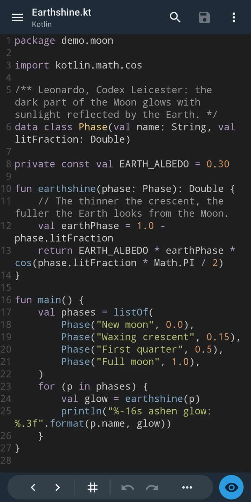</a>
<a href="lunaris-text-editor/">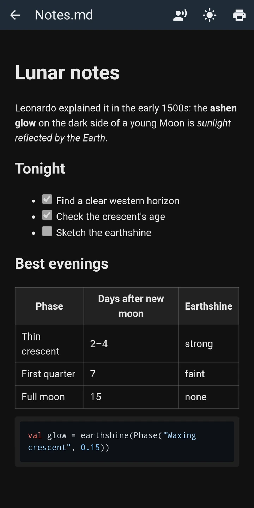</a>
<a href="lunaris-text-editor/">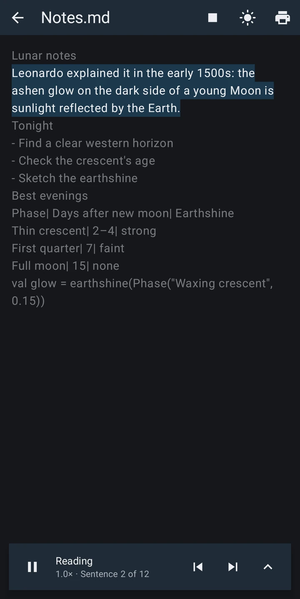</a>
<a href="lunaris-text-editor/">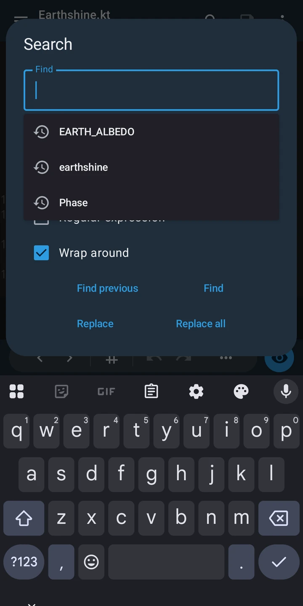</a>
<a href="lunaris-text-editor/">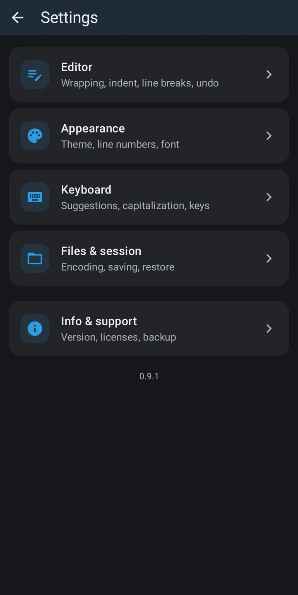</a>
</td>
</tr>
<tr>
<td width="96" align="center"></td>
<td><b><a href="lunaris-scanner/">Lunaris Scanner</a></b> A QR code and barcode scanner and generator: 16 formats read from an image, 15 of them from the camera too, warnings on suspicious links, a history that stays on the phone. The camera is the only system permission.  
<a href="lunaris-scanner/">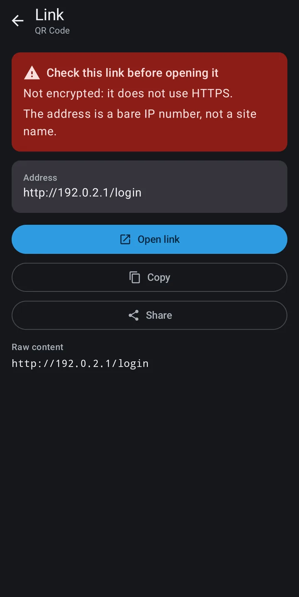</a>
<a href="lunaris-scanner/">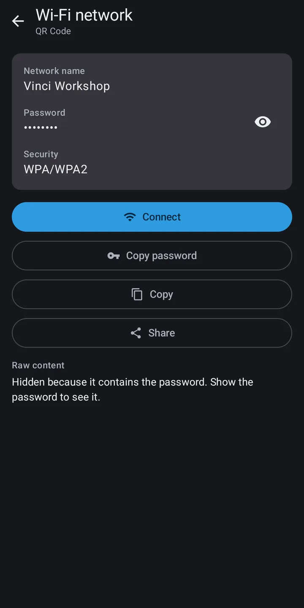</a>
<a href="lunaris-scanner/">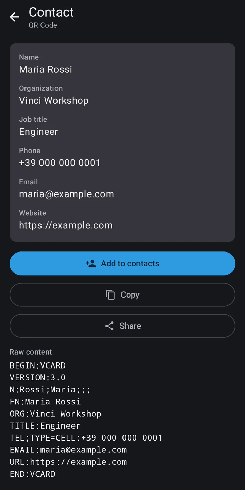</a>
<a href="lunaris-scanner/">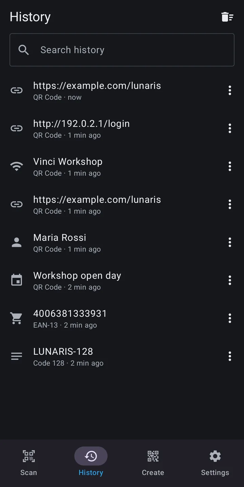</a>
<a href="lunaris-scanner/">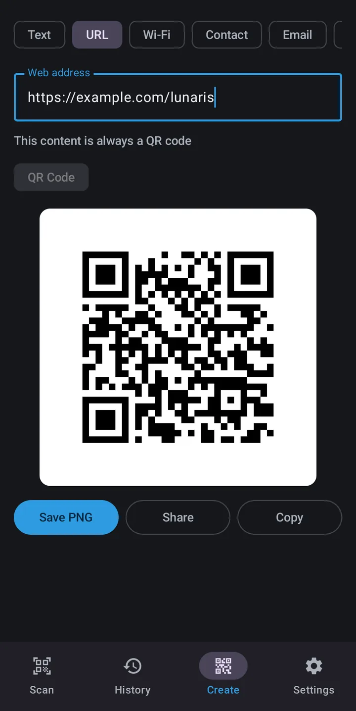</a>
</td>
</tr>
<tr>
<td width="96" align="center"><a href="lunaris-pdf/">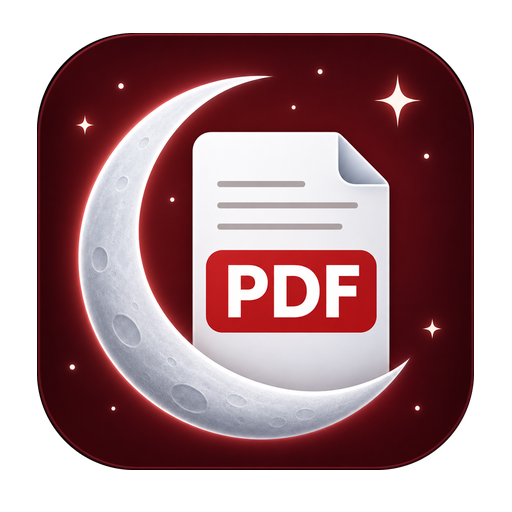</a></td>
<td><b><a href="lunaris-pdf/">Lunaris PDF</a></b> A PDF reader that opens straight to your document: a side scroller, search, contents, printing, and the JavaScript inside a PDF never runs. No system permissions at all.  
<a href="lunaris-pdf/">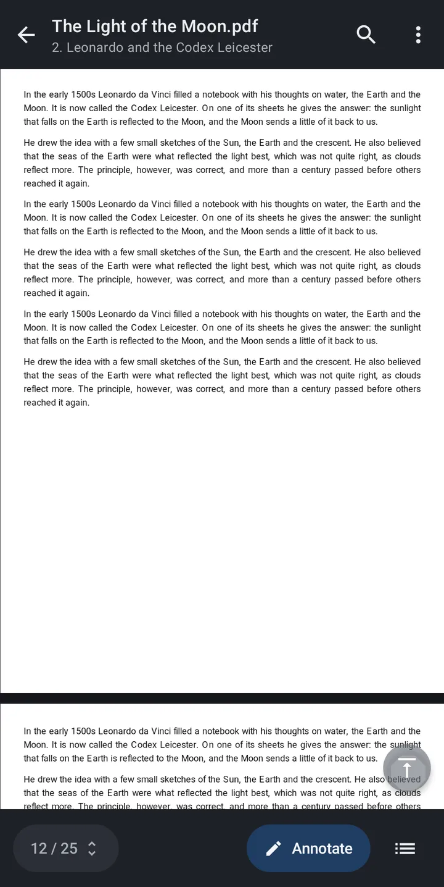</a>
<a href="lunaris-pdf/">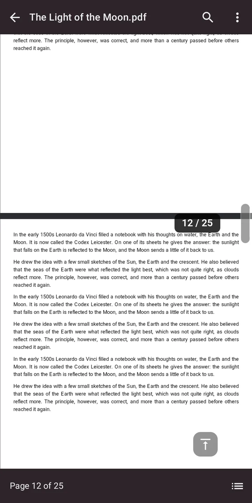</a>
<a href="lunaris-pdf/">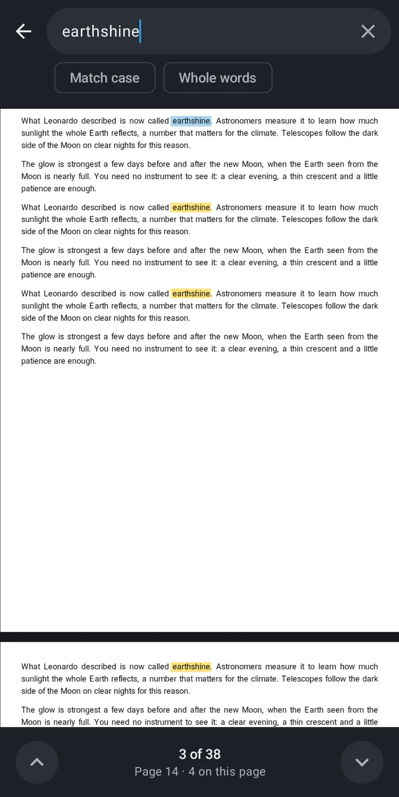</a>
<a href="lunaris-pdf/">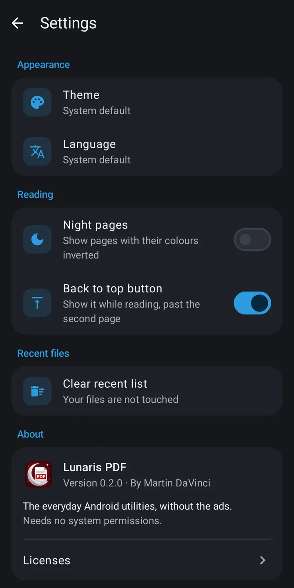</a>
<a href="lunaris-pdf/">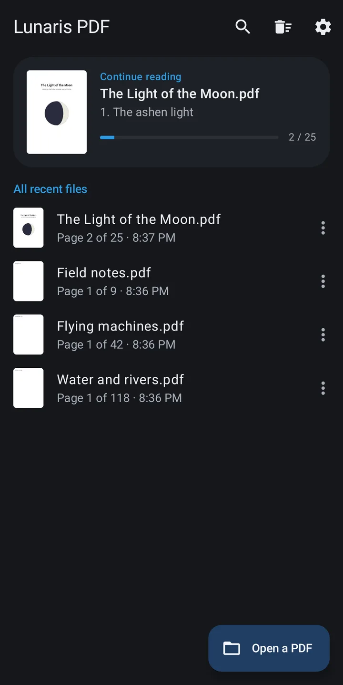</a>
</td>
</tr>
</table>

More everyday tools will join, one at a time.

## The same rules for every app

- **Offline.** No internet permission, no requests, nothing to sync.
- **No ads, no purchases, no account.** Every feature is there for everyone.
- **No tracking.** No analytics, no crash reporters, no third-party SDKs that phone home.
- **Only the permissions a tool truly needs**, listed in its README, with a way to check them yourself.
- **Free software**, under the GPL.

## Why "Lunaris"

In the early 1500s, in the notebook now called the Codex Leicester, Leonardo da Vinci explained the faint glow on the dark
part of a young Moon: it is sunlight reflected by the Earth, what we now call earthshine. Borrowed, quiet and steady:
the kind of light small tools should give.

## License

Lunaris is free software: you can redistribute it and modify it under the terms of the
[GNU General Public License](LICENSE), version 3 or any later version.

The names "Lunaris", the names of its apps and "Martin DaVinci", and the Lunaris logos are not licensed as
trademarks: a modified version you distribute needs a different name and a different icon. See
[TRADEMARKS.md](TRADEMARKS.md). Third-party components keep their own licenses, listed in each app.

## Contributing

Bug reports and ideas are welcome in the [issues](https://github.com/martindavinci/lunaris-essentials/issues).
For code, open an issue first so we can agree on the change: pull requests that were not discussed may be closed.
