<p align="center">
  
</p>

<h1 align="center">Lunaris Archives</h1>

<p align="center"><b>An archive app for Android that works offline: open ZIP, 7z and RAR files, take out one file or all of them, edit a file and put it back in the ZIP, open archives with a password, and make ZIP, 7z and TAR files. No ads.</b></p>

<p align="center">by <a href="https://github.com/martindavinci">Martin DaVinci</a></p>

<p align="center">
  <a href="https://github.com/martindavinci/lunaris-essentials/releases?q=lunaris-archives&expanded=true"></a>
  
  <a href="../LICENSE"></a>
</p>

<p align="center">
  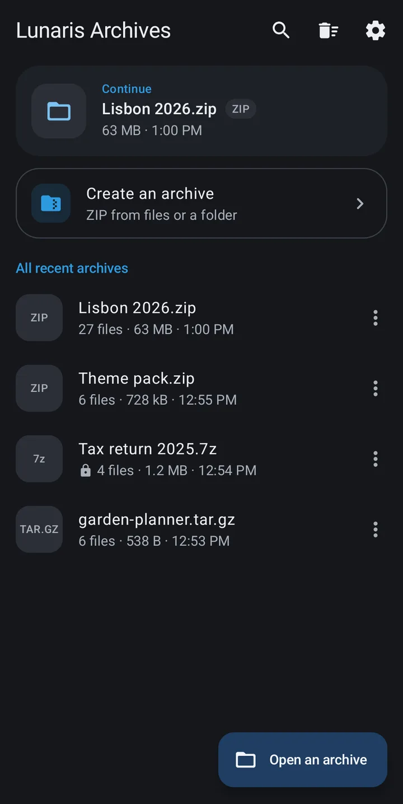
  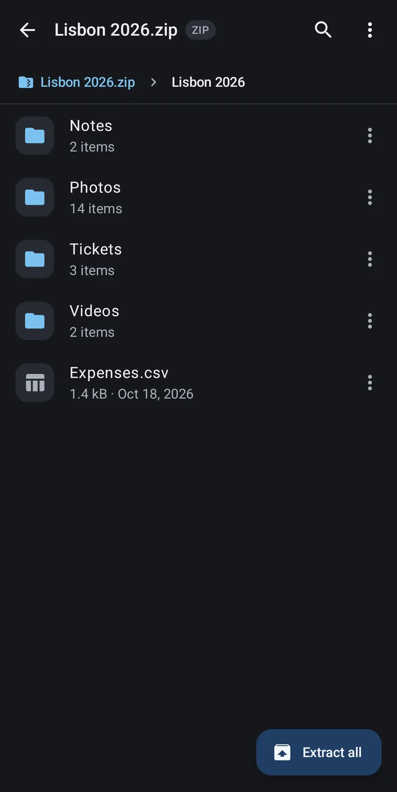
  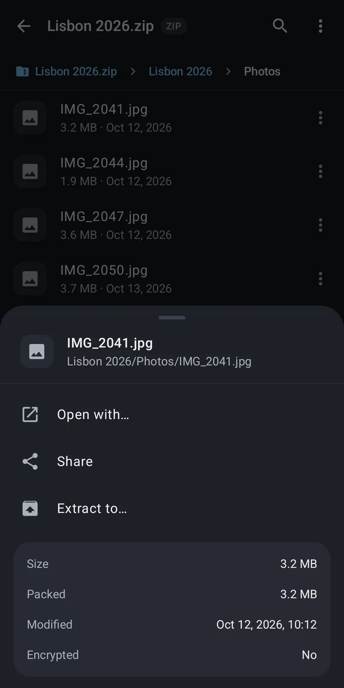
</p>
<p align="center">
  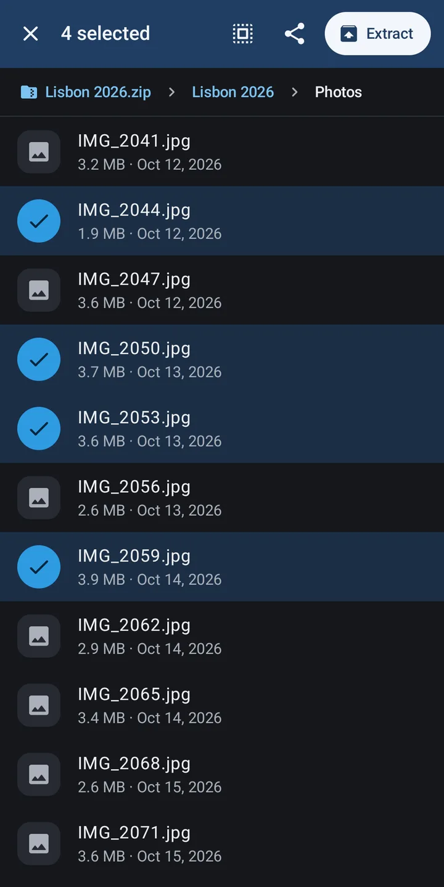
  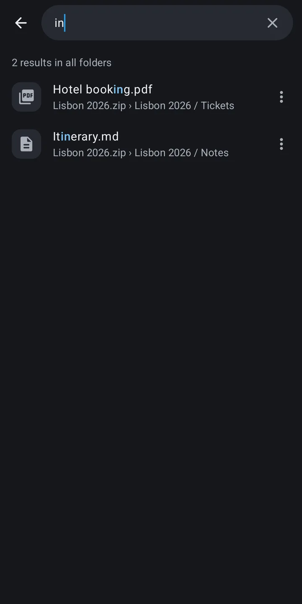
  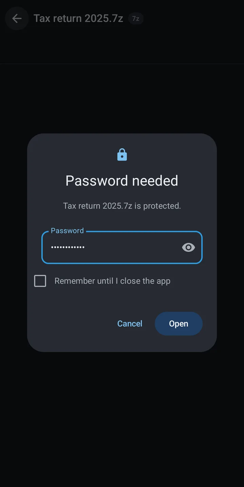
</p>
<p align="center">
  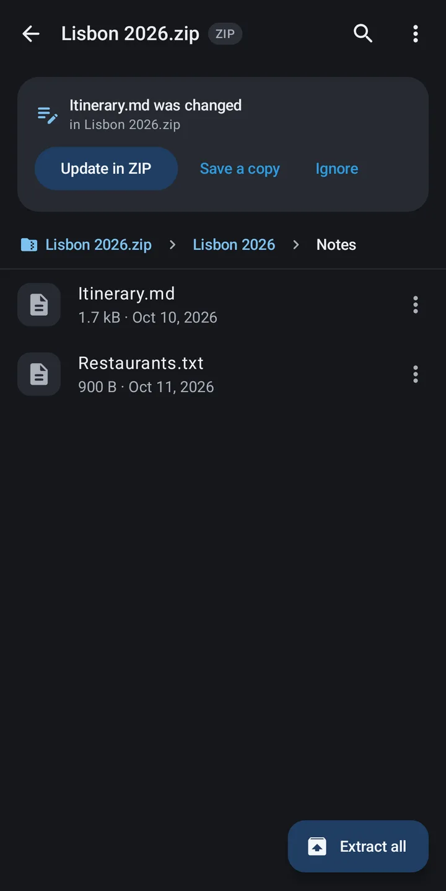
  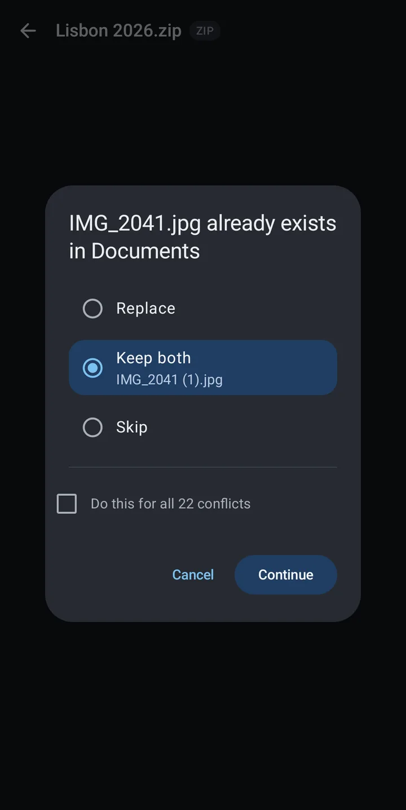
  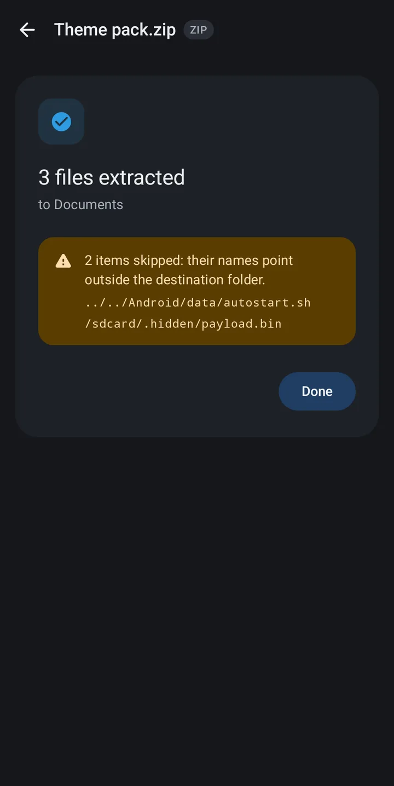
</p>
<p align="center">
  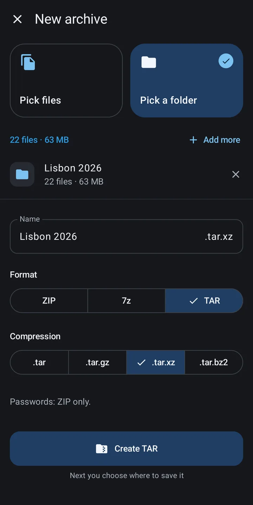
  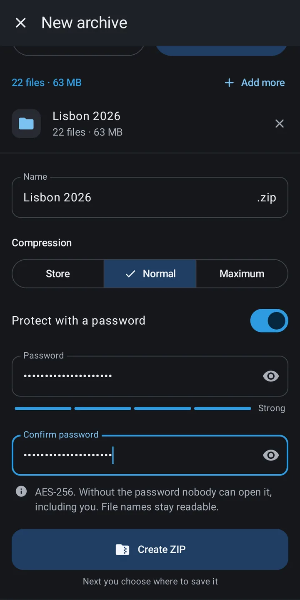
  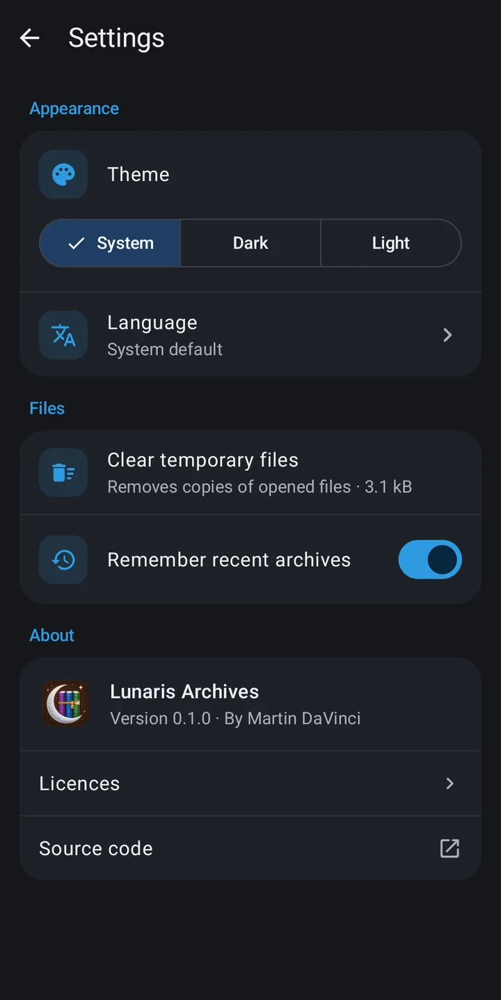
</p>

## Download

<p>
  <a href="https://github.com/martindavinci/lunaris-essentials/releases?q=lunaris-archives&expanded=true">Get the APK from GitHub Releases</a>
  &nbsp;·&nbsp;
  <a href="https://apps.obtainium.imranr.dev/redirect?r=obtainium://app/%7B%22id%22%3A%22io.github.martindavinci.lunaris.archives%22%2C%22url%22%3A%22https%3A%2F%2Fgithub.com%2Fmartindavinci%2Flunaris-essentials%22%2C%22author%22%3A%22martindavinci%22%2C%22name%22%3A%22Lunaris%20Archives%22%2C%22additionalSettings%22%3A%22%7B%5C%22includePrereleases%5C%22%3Afalse%2C%5C%22fallbackToOlderReleases%5C%22%3Atrue%2C%5C%22filterReleaseTitlesByRegEx%5C%22%3A%5C%22%5ELunaris%20Archives%20v%5C%22%2C%5C%22apkFilterRegEx%5C%22%3A%5C%22%5Elunaris-archives-%5B0-9.%5D%2B%5C%5C%5C%5C.apk%24%5C%22%2C%5C%22verifyLatestTag%5C%22%3Afalse%7D%22%7D"></a>
</p>

Each release has one APK, `lunaris-archives-<version>.apk`, for Android 8.0 or newer, on 64-bit and 32-bit ARM and on
x86_64. With [Obtainium](https://github.com/ImranR98/Obtainium) the app updates itself from this repository; the
button sets it up for you. To add it by hand, use this repository's URL and filter the release titles by
`^Lunaris Archives v`, since other Lunaris apps publish their releases here too.

## What it does

**Opening**
- From any app with "Open with" or "Share", from the file picker, or from the list of recent archives
- Folders, sizes and dates at once; sort, search by name, see what the archive holds and how it was made
- Tap a file and it opens in the app that handles it. Only that file is unpacked, into the app's own cache, and
  nothing else is extracted
- Share one file, a selection or the whole archive
- An archive inside an archive opens the same way
- The first screen offers the archive you had open, at the folder you were in

**Extracting**
- Everything, a selection or one folder, into a folder you choose with Android's picker
- When a file is already there: replace it, keep both, or skip it, for one file or for all of them
- A stopped or failed extraction leaves no half-written file behind

**Passwords**
- ZIP (ZipCrypto and AES), 7z and RAR5, including archives whose file names are hidden too
- The password is asked when it is needed. You can have it remembered until you close the app; it is never written
  to storage

**Editing a file inside a ZIP**
- Open a file in the app you edit it with, save it there, and come back: the app tells you it changed
- **Update in ZIP** puts it back in the archive, **Save a copy** saves it somewhere else, **Ignore** drops the change.
  Nothing is written into an archive unless you ask
- The archive is first copied aside and rebuilt beside it; it is replaced only when the new one reads back right. If
  the app is closed halfway, the archive is put back as it was the next time the app starts
- Only ZIP files can be updated; for 7z, RAR and the others a changed file can be saved as a copy
- The other entries of the ZIP are copied as they are, not compressed again. File permissions of an updated entry are
  not kept
- If the phone clears the app's cache before you come back, a change already noticed is kept; one not yet noticed is
  lost

**Creating**
- ZIP, 7z or TAR from files and folders you pick, or that another app shares with the app; a TAR can be packed with
  gzip, xz or bzip2
- Three levels of compression for ZIP and 7z, and an optional AES-256 password for ZIP, with a hint about how strong it
  is. 7z and TAR files are made without a password
- Saved where you choose, then opened, shared or left there

| Format | Open and extract | Password | Create |
|---|---|---|---|
| ZIP | yes | ZipCrypto, AES-128/192/256 | yes, AES-256 optional; changed files go back in |
| 7z | yes | AES-256, data and names | yes, without a password |
| RAR5 | yes | data and names | no |
| RAR4 | yes | no: no free app can read it | no |
| TAR, and TAR with GZ, BZ2, XZ, ZST or LZ4 | yes | — | TAR, TAR.GZ, TAR.XZ, TAR.BZ2 |
| GZ, BZ2, XZ, ZST, LZ4 (one file) | yes | — | no |
| ISO 9660, CPIO | yes | — | no |

Adding or removing files in an existing archive, and ZIP files split into parts, are not supported yet.

## How it stays safe

An archive can be made to harm the phone that opens it. This app reads every archive in a separate process that
Android isolates: it has no permissions, cannot see the app's files, and only gets the bytes of the archive. If it
crashes or is stopped, the app shows a message and carries on.

A file name that would land outside the folder you chose, like `../` or an absolute path, and links, are never
written. The app says which entries it skipped and why. An entry that unpacks to far more than its size is stopped
before it fills the phone, and the list of an archive stops at 200,000 entries.

## Privacy

The app has no system permissions. There is no internet permission, so it has no way to send anything anywhere, and no
storage permission: it can read only the archives you open with it and write only into the folders you choose, through
Android's own picker.

A recent archive is remembered only when Android lets the app keep its access to it; you can turn the list off in the
settings, which also gives that access back. For an archive whose file names are hidden by a password, the list keeps
no folder. The copies made to open single files stay in the app's cache, go away after a day, and can be cleared from
the settings; a copy you are editing in another app stays until you update the archive, save the copy or ignore it.
A changed file waiting for that choice, and the copy of an archive being updated, are kept in the app's own storage,
never written anywhere else.

There are no ads, no analytics and no account. Android's cloud backup is turned off for the app and its data is
excluded from device-to-device transfer.

You can check it yourself: the [manifest](app/src/main/AndroidManifest.xml) declares no system permission, and on a
downloaded APK

```
aapt2 dump permissions lunaris-archives-<version>.apk
```

lists only `io.github.martindavinci.lunaris.archives.DYNAMIC_RECEIVER_NOT_EXPORTED_PERMISSION`. AndroidX adds it so
that only the app itself can send messages to its own internal receivers; it gives access to nothing.

## Build from source

You need JDK 17 or newer, the Android SDK (platform 36), NDK 27.2.12479018 and CMake 3.31.5. The native libraries are
git submodules, so clone with them; the "Source code (zip)" of a GitHub release does not include them.

```
git clone --recurse-submodules https://github.com/martindavinci/lunaris-essentials.git
cd lunaris-essentials/lunaris-archives
./gradlew :lib-rar:test :app:testDebugUnitTest
./gradlew :app:assembleRelease
```

Point Gradle to your SDK with `ANDROID_HOME` or a `local.properties` file containing `sdk.dir=…`.
`tools/check-native.ps1` checks that the native libraries of a release build are aligned for 16 KB memory pages.

## License

The app's code is GPL-3.0-or-later, see [LICENSE](../LICENSE). It includes [lib-rar](lib-rar/LUNARIS.md) from
[Butler](https://github.com/d4rken-org/butler), licensed under the GNU GPL version 3 only, so the APK as a whole is
distributed under the terms of the GNU GPL version 3. The name "Lunaris Archives" and its icon are not licensed as
trademarks: see [TRADEMARKS.md](../TRADEMARKS.md).

Archives are read with [libarchive](https://www.libarchive.org) (BSD-2-Clause), with bzip2, XZ Utils (0BSD),
Zstandard (BSD-3-Clause) and LZ4 (BSD-2-Clause); ZIP files with a password and new ZIP files with
[zip4j](https://github.com/srikanth-lingala/zip4j), and 7z files with a password with
[Apache Commons Compress](https://commons.apache.org/proper/commons-compress/), both Apache-2.0. All the components and
their licenses are listed in the app, under Settings, Licences.
