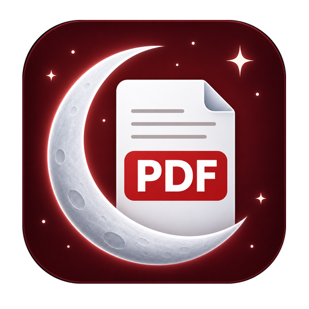
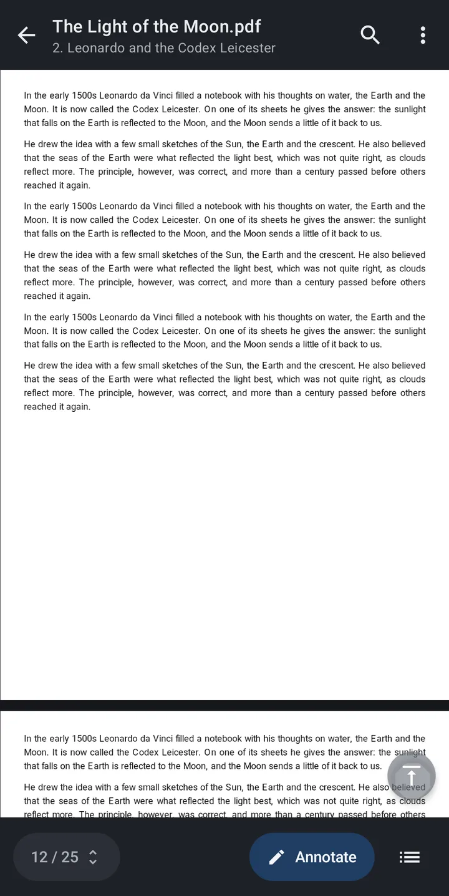
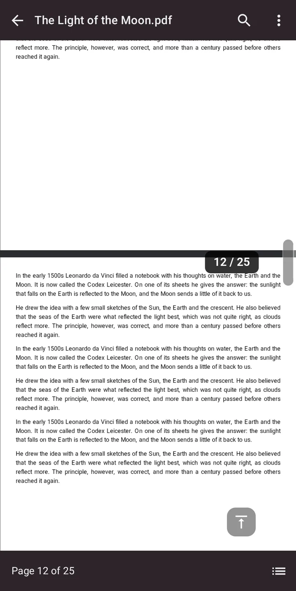
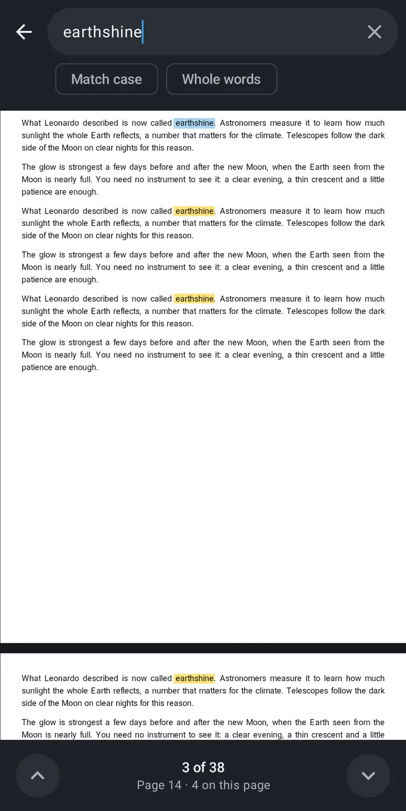
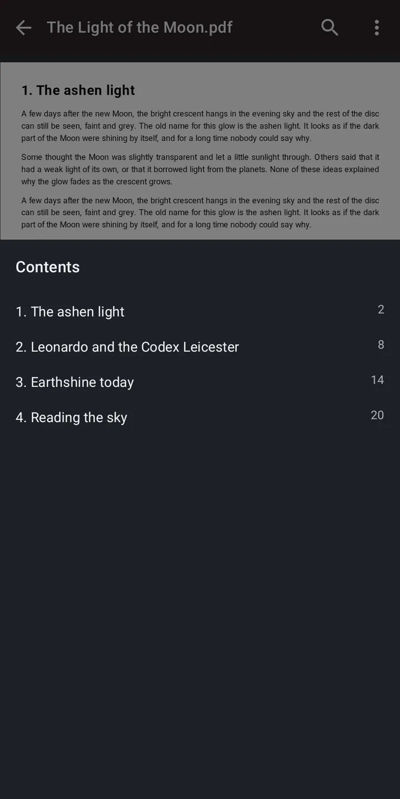
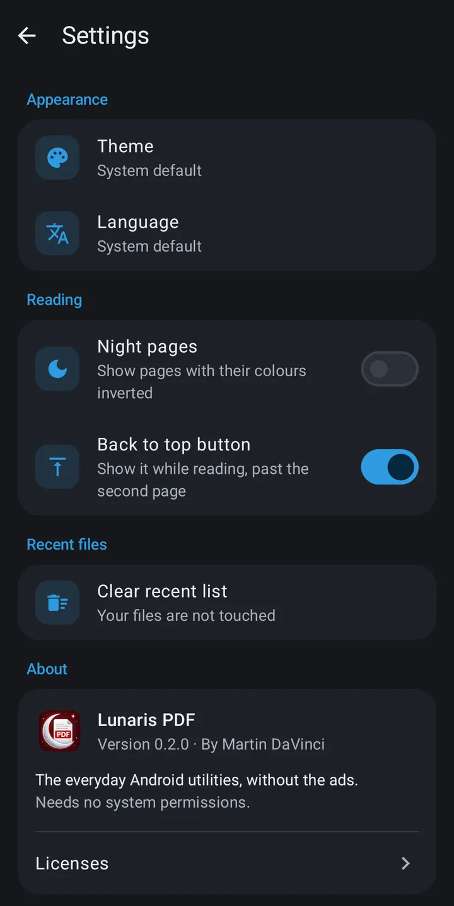
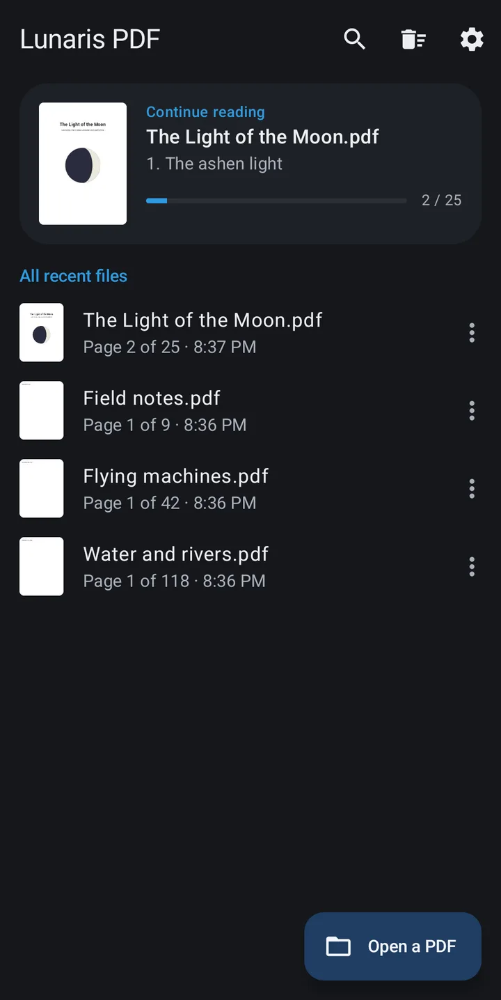

<p align="center">
  
</p>

<h1 align="center">Lunaris PDF</h1>

<p align="center"><b>A PDF reader for Android that works offline, opens straight to your document and shows no ads.</b></p>

<p align="center">by <a href="https://github.com/martindavinci">Martin DaVinci</a></p>

<p align="center">
  <a href="https://github.com/martindavinci/lunaris-essentials/releases?q=lunaris-pdf&expanded=true"></a>
  
  <a href="../LICENSE"></a>
</p>

<p align="center">
  
  
  
</p>
<p align="center">
  
  
  
</p>

## Download

<p>
  <a href="https://github.com/martindavinci/lunaris-essentials/releases?q=lunaris-pdf&expanded=true">Get the APK from GitHub Releases</a>
  &nbsp;·&nbsp;
  <a href="https://apps.obtainium.imranr.dev/redirect?r=obtainium://app/%7B%22id%22%3A%22io.github.martindavinci.lunaris.pdf%22%2C%22url%22%3A%22https%3A%2F%2Fgithub.com%2Fmartindavinci%2Flunaris-essentials%22%2C%22author%22%3A%22martindavinci%22%2C%22name%22%3A%22Lunaris%20PDF%22%2C%22additionalSettings%22%3A%22%7B%5C%22includePrereleases%5C%22%3Afalse%2C%5C%22fallbackToOlderReleases%5C%22%3Atrue%2C%5C%22filterReleaseTitlesByRegEx%5C%22%3A%5C%22%5ELunaris%20PDF%20v%5C%22%2C%5C%22apkFilterRegEx%5C%22%3A%5C%22%5Elunaris-pdf-%5B0-9.%5D%2B%5C%5C%5C%5C.apk%24%5C%22%2C%5C%22verifyLatestTag%5C%22%3Afalse%7D%22%7D"></a>
</p>

Each release has one APK, `lunaris-pdf-<version>.apk`, for Android 8.0 or newer. With
[Obtainium](https://github.com/ImranR98/Obtainium) the app updates itself from this repository; the button sets it
up for you. To add it by hand, use this repository's URL and filter the release titles by `^Lunaris PDF v`,
since other Lunaris apps publish their releases here too.

## What it does

**Opening**
- From any app with "Open with" or "Share", from the file picker, or from the list of recent documents
- Nothing between you and the page: no login, no welcome screens, no popups
- PDFs with a password; the password is asked each time and never stored
- Comes back to the page and zoom where you left a document
- The first screen offers the document you were reading, with its chapter and how far you got
- Below it all your recent documents, with their first page; search them, pin up to three, or remove one

**Reading**
- Continuous scrolling, pinch to zoom, double tap to fit the width
- A side scroller to move through the whole document, with the page and the chapter as you drag
- A button that goes back to the first page, past the second one; you can hide it in the settings
- After a long move, a button goes back to where you were
- Search as you type, with the matches counted, whole words and upper case if you want them
- Select and copy text, contents, go to page
- Night pages, with the colours of the page inverted, and a light, dark or system theme

**With the document**
- Print it, share it, save a copy

**Links are never opened by themselves.** The app shows the whole address first, and warns about one that is not HTTPS,
uses punycode or non-ASCII characters in its host, points to an IP address, embeds a username or password, or uses an
unusual port. Only `http` and `https` links can be opened; other kinds can only be copied.

## Privacy

The app has no system permissions. There is no internet permission, so it has no way to send anything anywhere, and no
storage permission: it can read only the files you open with it, through Android's own picker and "Open with".

A PDF can contain JavaScript. This app never runs it, and does not even include the part of its PDF engine that could.
The pages are drawn in a web view that loads nothing but the app's own files and the document you opened.

There are no ads, no analytics and no account. The list of recent documents holds where each file is, its name, the
page, the zoom, the title of the chapter you are in and a small picture of the first page. A document with a password
keeps neither the title nor the picture. All of this stays on the phone and goes away with the list: Android's cloud
backup is turned off for the app and its data is excluded from device-to-device transfer, although Android lets some
phone makers' migration tools ignore that setting. A link
you choose to open is handled by your browser, which uses its own network access, not the app's.

You can check it yourself: the [manifest](app/src/main/AndroidManifest.xml) declares no system permission, and on a
downloaded APK

```
aapt2 dump permissions lunaris-pdf-<version>.apk
```

lists only `io.github.martindavinci.lunaris.pdf.DYNAMIC_RECEIVER_NOT_EXPORTED_PERMISSION`. AndroidX adds it so that only
the app itself can send messages to its own internal receivers; it gives access to nothing.

## Build from source

You need JDK 17 or newer and the Android SDK (platform 36).

```
git clone https://github.com/martindavinci/lunaris-essentials.git
cd lunaris-essentials/lunaris-pdf
./gradlew :app:testDebugUnitTest
./gradlew :app:assembleRelease
```

Point Gradle to your SDK with `ANDROID_HOME` or a `local.properties` file containing `sdk.dir=…`. The pdf.js files in
`app/src/main/assets/viewer` come from `tools/pdfjs/fetch-pdfjs.ps1`, which checks them against `manifest.json`.

## License

GPL-3.0-or-later, see [LICENSE](../LICENSE). The name "Lunaris PDF" and its icon are not licensed as trademarks: see
[TRADEMARKS.md](../TRADEMARKS.md). Documents are drawn with [PDF.js](https://github.com/mozilla/pdf.js), under the
Apache-2.0 license like Jetpack Compose, DataStore and Dagger Hilt. The components shipped with PDF.js keep their own
licenses; all of them are listed in the app, under Settings, Licenses.
