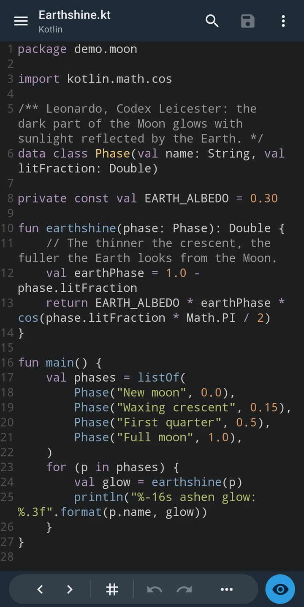
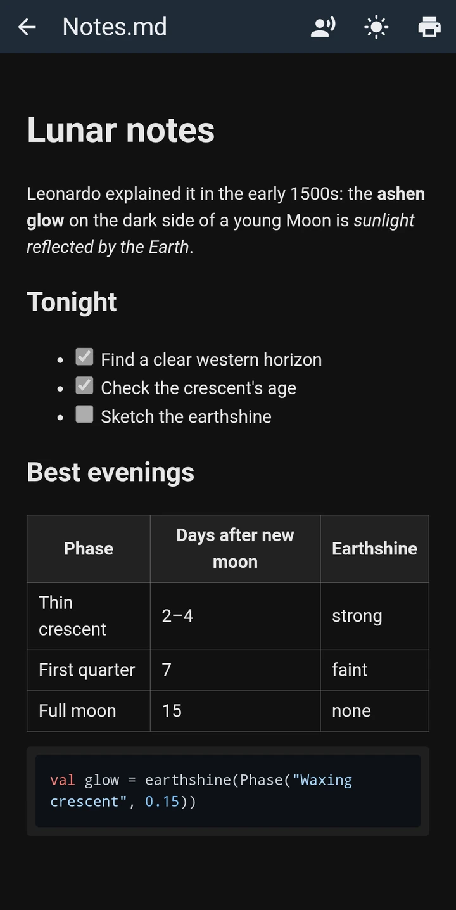
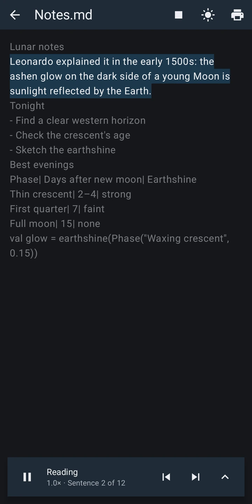
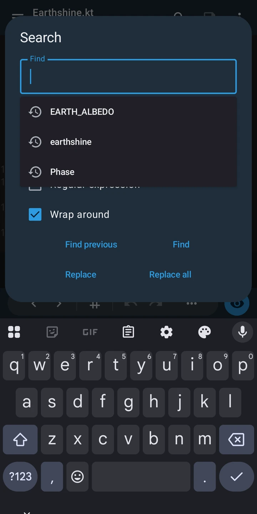
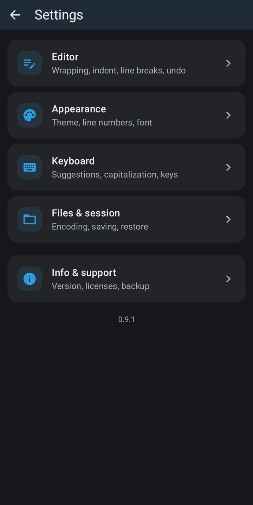
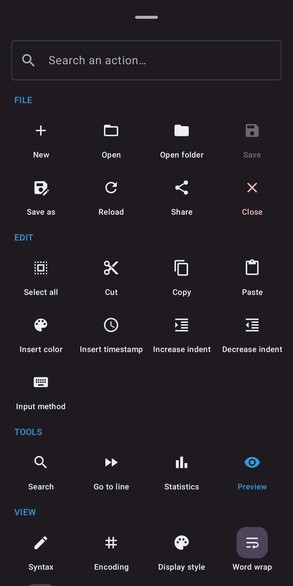

<h1 align="center">Lunaris Text Editor</h1>

<p align="center"><b>A text and code editor for Android that works offline, shows no ads and needs no permissions.</b></p>

<p align="center">
  <a href="https://github.com/martindavinci/lunaris-essentials/releases?q=lunaris-text-editor&expanded=true"></a>
  
  <a href="../LICENSE"></a>
</p>

<p align="center">
  
  
  
</p>
<p align="center">
  
  
  
</p>

## Download

<p>
  <a href="https://github.com/martindavinci/lunaris-essentials/releases?q=lunaris-text-editor&expanded=true">Get the APK from GitHub Releases</a>
  &nbsp;·&nbsp;
  <a href="https://apps.obtainium.imranr.dev/redirect?r=obtainium://app/%7B%22id%22%3A%22io.github.martindavinci.lunaris.texteditor%22%2C%22url%22%3A%22https%3A%2F%2Fgithub.com%2Fmartindavinci%2Flunaris-essentials%22%2C%22author%22%3A%22martindavinci%22%2C%22name%22%3A%22Lunaris%20Text%20Editor%22%2C%22additionalSettings%22%3A%22%7B%5C%22includePrereleases%5C%22%3Afalse%2C%5C%22fallbackToOlderReleases%5C%22%3Atrue%2C%5C%22filterReleaseTitlesByRegEx%5C%22%3A%5C%22%5ELunaris%20Text%20Editor%20v%5C%22%2C%5C%22apkFilterRegEx%5C%22%3A%5C%22%5Elunaris-text-editor-%5B0-9.%5D%2B%5C%5C%5C%5C.apk%24%5C%22%2C%5C%22verifyLatestTag%5C%22%3Afalse%7D%22%7D"></a>
</p>

Each release has one APK, `lunaris-text-editor-<version>.apk`, for Android 8.0 or newer. With
[Obtainium](https://github.com/ImranR98/Obtainium) the app updates itself from this repository; the button sets it
up for you. To add it by hand, use this repository's URL and filter the release titles by `^Lunaris Text Editor v`,
since other Lunaris apps publish their releases here too.

## What it does

**Editing**
- Syntax highlighting for 54 languages, picked from the file's extension or by hand, with your own extension →
  language rules
- 12 color schemes (Dracula, Nord, One Dark, Gruvbox, Solarized and more), light, dark and black app themes
- Tabs, with the open files restored on the next launch
- Search and replace, with case, regular expressions and wrap-around; each file remembers its recent searches
- Go to line, undo and redo, cut, copy, paste, select all, indent and outdent, insert a color or a timestamp
- Word wrap, read-only mode, word and character count
- A bottom toolbar you can rearrange, an accessory row of special characters, and every action in one searchable
  sheet

**Files**
- Opens the files you pick, the folders you grant (browse, create, rename) and the recent files list
- Shows up in "Open with" for text and code files, and receives text or files shared from other apps
- Detects the encoding and keeps the byte order mark and line endings; you can pick another encoding or line ending
- Save, save as, autosave at an interval you choose, share the document as a file
- Remembers the cursor position of each file

**Preview**
- Markdown with tables, task lists and highlighted code blocks; HTML; code files in a print-friendly page
- Light or dark, and print or save as PDF through Android's print dialog
- **Read aloud**: the preview is spoken sentence by sentence and each sentence is highlighted, with voice and speed
  of your choice

**Settings**
- Font, size, line spacing, line numbers, indentation, default encoding and line ending, fullscreen and more
- Back up all settings to a file and restore them on another phone
- In English, Italian, German, Spanish, French, Portuguese, Polish, Dutch and Japanese

## Privacy

The app asks for no system permissions: no internet, no storage, no contacts, nothing. It reads only the files and
folders you choose through Android's own pickers, and it has no way to send anything anywhere. There are no ads, no
analytics and no account. Android's cloud backup is turned off for it, so even the text of unsaved tabs never leaves
the phone.

You can check it yourself: the [manifest](app/src/main/AndroidManifest.xml) declares no permissions, and on a
downloaded APK

```
aapt2 dump permissions lunaris-text-editor-<version>.apk
```

lists a single line, `io.github.martindavinci.lunaris.texteditor.DYNAMIC_RECEIVER_NOT_EXPORTED_PERMISSION`. AndroidX
adds it so that only the app itself can send messages to its own internal receivers; it gives access to nothing.

Read aloud uses the text-to-speech engine installed on your phone. Voices the engine marks as "requires connection"
use the engine's own network access, not the app's.

## Build from source

You need JDK 17 or newer and the Android SDK (platform 36).

```
git clone https://github.com/martindavinci/lunaris-essentials.git
cd lunaris-essentials/lunaris-text-editor
./gradlew :app:testDebugUnitTest
./gradlew :app:assembleRelease
```

Point Gradle to your SDK with `ANDROID_HOME` or a `local.properties` file containing `sdk.dir=…`.

## License

GPL-3.0-or-later, see [LICENSE](../LICENSE). The name "Lunaris Text Editor" and its icon are not licensed as
trademarks: see [TRADEMARKS.md](../TRADEMARKS.md). Third-party components and their licenses are listed in the app
under Settings → Open-source licenses: Sora Editor (LGPL-2.1), TextMate grammars from Shiki and base16 themes (MIT),
highlight.js (BSD-3-Clause), commonmark-java (BSD-2-Clause), AndroidX, Jetpack Compose and Dagger Hilt (Apache-2.0).
